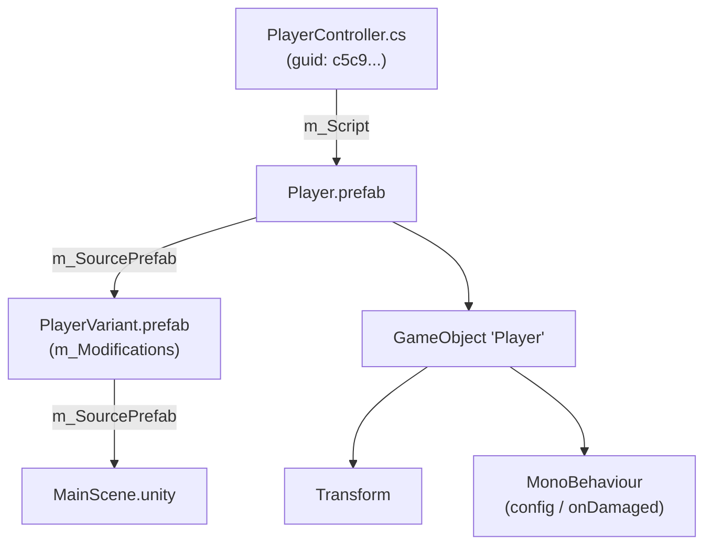
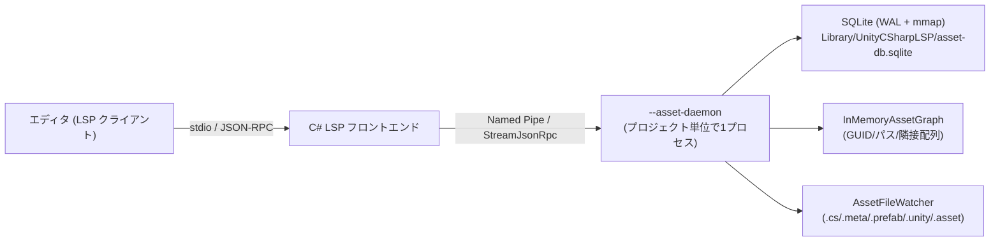

# Scene / Prefab / GameObject 設計

> UnityCSharpLSP が `.prefab` / `.unity` / `.asset` をどう解釈し、LSP の各プロトコルへどう写像するかを定義する。
> 全体構成は [design.md](design.md)、データサーバの詳細は [prefabserver.md](prefabserver.md) / [prefabserver-detaildesign.md](prefabserver-detaildesign.md) を参照。

## 1. 目的とスコープ

C# 言語サーバは `.cs` しか見ないため、Unity プロジェクトでは次の情報が欠落する。

- スクリプトがどの Prefab / Scene にアタッチされているか
- Prefab がどの Scene に配置されているか（間接参照）
- シリアライズフィールドの値がどこで上書きされているか
- GameObject / Component / PrefabInstance の階層構造

本設計では、これらを **Asset Daemon が一元的にインデックスし、既存の LSP メソッドへ「追加情報」としてマージする**。新しい LSP メソッドは導入せず、クライアント側の追加設定なしで動くことを原則とする。

## 2. Unity データモデル

### 2.1 識別子

| 概念 | 表現 | 備考 |
|---|---|---|
| アセット | 32桁 GUID（`.meta` の `guid:`） | `AssetGuid` (UInt128)。`0000...` は無効、`e000...` 系は Unity ビルトインとして除外 |
| アセット内のオブジェクト | `--- !u!<classId> &<fileID>` の `fileID` | ファイル内ローカル。GUID と fileID の組で一意 |
| 参照 | `{fileID: <n>, guid: <32hex>, type: <n>}` | `guid` が別アセット、`fileID: 0` が null 参照 |

### 2.2 対象 Class ID

`FastUnityYamlScanner` / `HierarchyBuilder` が注目するブロックは限定的で、Mesh や Lightmap 等は高速スキップする。

| Class ID | 意味 | 用途 |
|---|---|---|
| `1` | GameObject | 階層ノード、`m_Name` |
| `4` / `224` | Transform / RectTransform | 親子関係、`m_RootOrder` |
| `114` | MonoBehaviour | `m_Script`、シリアライズフィールド、`UnityEvent` |
| `1001` | PrefabInstance | `m_SourcePrefab`、`m_Modifications` |
| `1660057539` | SceneRoots | シーンルートの明示的順序 |

`AssetKind` は `CSharpScript=1 / Prefab=2 / Scene=3 / ScriptableObject=4 / OtherAsset=5`。

### 2.3 階層とオーバーライド



Prefab Variant や Scene は `PlayerController.cs` の GUID を直接持たない。**`Script → Prefab → Variant → Scene` の有向グラフを辿る必要がある**ため、単純文字列検索ではなくグラフ構造で保持する。

`m_Modifications` は `target.guid` + `target.fileID` + `propertyPath` で元 Prefab の特定メンバを上書きする。Overridden 値の追跡に使う。

## 3. インデックス構成

### 3.1 プロセス構成



- フロントエンドは Roslyn と LSP 通信のみを担当し、YAML スキャンや SQLite を持たない。
- デーモンは `Assets/` と `Packages/` を走査し、`Library/` は除外する。
- 1 ファイル変更は `DELETE WHERE asset_id = ?` + `INSERT` の差分更新（数 ms）。

### 3.2 永続テーブル

| テーブル | 内容 |
|---|---|
| `assets` | GUID、相対パス、`AssetKind`、mtime / size |
| `script_attachments` | MonoBehaviour の `m_Script`（asset_id, component_fid, game_object_name, line） |
| `prefab_instances` | `m_SourcePrefab`（asset_id, prefab_instance_fid, source_guid, line） |
| `prefab_modifications` | `propertyPath` による上書き（target_guid, target_fid, root_field_name） |
| `serialized_fields` | カスタムフィールド名と参照 GUID / fileID |
| `unity_event_calls` | `m_MethodName` と呼び出し先 |

### 3.3 読み取りモデル

`AssetGraphSnapshot` は immutable で、`AssetIdByGuid` / `AssetIdByRelPath` / `ScriptToDirectAssetIds` / `PrefabGuidToInstantiatingAssetIds` を保持する。CodeLens の参照数などは SQL を発行せずこのスナップショットから応答する。

## 4. LSP プロトコルへの写像

「Prefab 情報をどう送るか」は、既存メソッドの `result` を拡張する形で設計する。

### 4.1 マッピング一覧

| LSP メソッド | Prefab / Scene 情報の扱い | 実装 |
|---|---|---|
| `textDocument/definition` | YAML の `guid:` から `.cs` / `.prefab` / アセットの位置を返す | `DefinitionHandler` + `assetd/getDefinition` |
| `textDocument/references` | C# 参照 + 直接/間接の Prefab・Scene 参照をマージ | `ReferencesHandler` + `assetd/findReferences` |
| `textDocument/hover` | アセットパス・種別・C# シグネチャ・XML docs・`[Tooltip]` を合成 | `HoverHandler` + `assetd/getHover` |
| `textDocument/completion` | `guid:` 行でインデックス済みアセットを名前補完し GUID を挿入 | `CompletionHandler` + `assetd/getAssets` |
| `textDocument/documentSymbol` | GameObject / Component / PrefabInstance の階層ツリー | `DocumentSymbolHandler` + `assetd/getHierarchy` |
| `textDocument/documentLink` | `guid:` 参照、シーン名をリンク化 | `DocumentLinkHandler` + `assetd/getDocumentLinks` |
| `textDocument/codeLens` | `N references (P prefabs, S scenes)` | `CodeLensHandler` + `assetd/getScriptReferenceCounts` |
| `textDocument/rename` | YAML キー / `propertyPath` / `m_MethodName` を横断更新（opt-in） | `RenameHandler` + `assetd/computeRenameEdits` |
| `textDocument/codeAction` | `[FormerlySerializedAs]` 追加 | `CodeActionHandler` + Roslyn |
| `textDocument/publishDiagnostics` / `diagnostic` | `UNITY0001` Missing Script、`UNITY0002` Dangling Asset Reference（opt-in）、`UNITY0003` Prefab Override Impact（opt-in） | `DiagnosticsHandler` + `assetd/getAssetDiagnostics` |
| `workspace/executeCommand` | 階層取得、アセット内使用検索、ステータス | `ExecuteCommandHandler` |

### 4.2 階層取得の例

```json
// workspace/executeCommand: unitycsharp.getSceneOrPrefabHierarchy
{
  "name": "Player",
  "isPrefabInstance": false,
  "components": [
    { "typeName": "Transform", "classId": 4 },
    { "typeName": "PlayerController", "scriptGuid": "c5c9..." }
  ],
  "children": []
}
```

`HierarchyBuilder` は `m_Transform` / `m_Father` / `m_Children` と `m_RootOrder`（または SceneRoots）から親子を再構築する。PrefabInstance は `SourcePrefabPath` と `SourcePrefabGuid` を保持し、`IsPrefabInstance = true` で表現する。

### 4.3 GUID 補完の例

```json
// textDocument/completion（YAML の "  m_Script: {..., guid: |" 上）
[
  {
    "label": "PlayerController",
    "kind": 7,
    "detail": "Assets/Scripts/PlayerController.cs",
    "insertText": "c5c9d31933d241c4b9047a5783f7f380"
  }
]
```

`m_Script` 行はスクリプトのみ、`m_SourcePrefab` 行は Prefab のみ、それ以外は全アセットを候補とする（最大 500 件）。

## 5. 診断と設定

| Code | 意味 | 既定 |
|---|---|---|
| `UNITY0001` | Missing Script — `script_attachments` の GUID が `assets` に存在しない | 有効 |
| `UNITY0002` | Dangling Asset Reference — 解決できない `guid:` 参照（削除された Prefab / アセット） | 無効（opt-in） |
| `UNITY0003` | Prefab Override Impact — 子の `m_Modifications` が元 Prefab のフィールドを上書きしている | 無効（opt-in） |

`UNITY0002` を既定無効としているのは、`Library/PackageCache` 内の GUID がインデックス対象外で誤検出になるため。`Packages/` が揃っている環境で `reportDanglingAssetReferences: true` を設定して有効化する。

`UNITY0003` も既定無効である。上書きは意図的なカスタマイズであることが多いため、ノイズを避けるためである。`reportPrefabOverrideImpact: true` を設定して有効化する。`prefab_modifications` を `target_guid` + `target_fid` で逆引きし、上書き元の Prefab 名をメッセージに埋め込む。診断は `propertyPath` 行（`prefab_modifications.line_number`）にRange を付け、push / pull ともに `DiagnosticsHandler` でフィルタされる。

| 設定 | 既定 | 効果 |
|---|---|---|
| `enableDiagnostics` | `true` | push 診断の有効/無効 |
| `predefinedSymbols` | `[]` | 定義シンボル追加 |
| `propagateRenamesToAssets` | `false` | YAML への rename 伝播（Unity Editor と書き込み競合する可能性があるため opt-in） |
| `reportDanglingAssetReferences` | `false` | `UNITY0002` の公開 |
| `reportPrefabOverrideImpact` | `false` | `UNITY0003` の公開 |

各設定は snake_case エイリアス（例: `report_prefab_override_impact`）でも受け付ける。

## 6. 未実装項目と拡張方針

資料で挙がっている機能のうち、現在の実装状況と今後の設計方針は次の通り。

| 機能 | 状況 | 方針 |
|---|---|---|
| Prefab 定義へのジャンプ / 参照検索 / 階層表示 | 実装済み | 現状維持 |
| Prefab 内 GameObject のプロパティ補完（`transform` 等） | 未 | `assetd/getHierarchy` の Component 名を Roslyn のスコープ補完へマージする。**C# 側の型情報と GameObject 名を混同しないよう、補完種別を分ける必要がある** |
| `GetComponent<RectTransform>()` のコンポーネント補完 | 未 | `m_EditorClassIdentifier` / `classId` から型名を抽出し、`GetComponent<` の型引数候補として提示。`ClassId → Unity 型名` のマッピング表が必要 |
| `semanticTokens` による Prefab 内 GameObject の色分け | 未 | YAML を LSP テキストとして扱い、`!u!1` ブロックの `m_Name` 行にトークンを付与。クライアントが YAML を LSP ルーティングする必要がある |
| `workspace/symbol` で Prefab を検索 | 実装済み | `assetd/getAssets` の結果を C# シンボル検索の後にマージし、`kind` を `File` に割り当てる（C# 結果を優先、最大 200 件） |
| Prefab 変更がインスタンスに与える影響の警告 | 実装済み | `prefab_modifications` を `target_guid` + `target_fid` で逆引きし、`UNITY0003` として診断（既定 opt-in）。上書きを意図したカスタマイズと区別できないため `reportPrefabOverrideImpact` での有効化を前提とする |
| スクリプトが Prefab にアタッチされていない場合の警告 | 実装済み | `MonoBehaviour` / `ScriptableObject` のうち `script_attachments` に一度も現れない型を `UNITY0004` として C# 側へヒントを出す。アセットとして未使用なだけの場合もあるため `Hint` 扱い・opt-in（`reportUnattachedScripts`） |
| Prefab 削除時に参照元スクリプトへ警告 | 一部 | `UNITY0002` は「アセット側から消えた Prefab への参照」を検出する。逆方向（C# 側が削除済み Prefab を想定している）は `ExecuteCommand` の使用検索結果と組み合わせて診断化する |
| Unity 固有の誤検知の抑制 | 実装済み | `[SerializeField]` の `CS0649`、`UnityEvent` 参照メソッドの `IDE0051` を `SerializeFieldSuppressor` で抑制。Unity API 自体が未インストールの場合の抑制は未対応 |
| Unity / 非 Unity プロジェクトの切り分け | 実装済み | Roslyn ワークスペースを `ProjectSettings/` + `.asmdef` から構築するため、Unity でないプロジェクトでは `UnityEngine` は参照されない |

## 7. パフォーマンスとスケール

Unity プロジェクトは数万の Prefab / Scene と十数万の `.meta` を抱える。解析を LSP 応答のクリティカルパスに置かないための設計。

### 7.1 現在の対策

| 対策 | 実装 |
|---|---|
| シングルパス UTF-8 スキャン | `FastUnityYamlScanner` が `ReadOnlySpan<byte>` を 1 パスで走査し、文字列を生成しない（`assetd/getAssets` 等の補助 API もスナップショットを返す） |
| 対象ブロックの高速スキップ | Mesh / Lightmap / RenderSettings 等は `\n--- !u!` まで `IndexOf` で飛ばす。100MB の Scene でも数 GB/s で読み進める |
| 差分索引更新 | `AssetFileWatcher` がデバウンスし、変更されたアセットだけ `DELETE` + `INSERT`。初回スキャン後は再スキャン不要 |
| GC ヒープの抑制 | `m_Modifications` / `UnityEvent` は SQLite + mmap に逃がし、C# 側の RAM を増やさない |
| SQL レスポンス | 参照数や GUID 解決は `InMemoryAssetGraph` のスナップショットから応答（I/O ゼロ） |
| 補完の上限 | GUID 補完は最大 500 件で打ち切り、巨大プロジェクトでのレスポンス肥大を防止 |
| 階層ビルドのキャッシュ | `HierarchyCache`（既定 256 エントリ・LRU）が同一 `(assetPath, maxDepth, includeSerializedValues)` のスキャン結果を再利用。`AssetFileWatcher` の差分更新で該当エントリを、フル rescan で全エントリを無効化 |
| PackageCache GUID の二段解決 | `PackageCacheGuidIndex` が `Library/PackageCache` 配下の `.meta` GUID を初回利用時に一度だけ並列構築してプロセス内で共有。`UNITY0002` を出す前に照合し、パッケージ内アセットの誤検出を抑制 |
| 診断の差分発行 | `PullDiagnosticsHandler` / `WorkspaceDiagnosticsHandler` が `UNITY0001`〜`UNITY0004` の内容（コード・Range・メッセージ）を `resultId` に含め、同一なら `unchanged` を返す |

### 7.2 今後の改善候補

- **初期スキャンの並列化**: `Assets/` と `Packages/` の走査をファイル単位で並列化し、初回 `Ready` までの時間を短縮する（SQLite への書き込みは Single Writer を維持）。

なお、階層ビルドのキャッシュ、GUID 解決の二段構え、診断の差分発行は 7.1 の通り実装済み。

## 8. 主要ソース

| 領域 | ファイル |
|---|---|
| YAML スキャン | `src/UnityCSharpLSP.AssetServer/Parsing/FastUnityYamlScanner.cs`, `UnityYamlSpanReader.cs` |
| 階層構築 | `src/UnityCSharpLSP.AssetServer/Parsing/HierarchyBuilder.cs` |
| GUID / meta | `src/UnityCSharpLSP.AssetServer/Parsing/MetaFileParser.cs`, `Storage/AssetGuid.cs` |
| 永続化 / グラフ | `src/UnityCSharpLSP.AssetServer/Storage/AssetSqliteStore.cs`, `InMemoryAssetGraph.cs` |
| デーモン | `src/UnityCSharpLSP.AssetServer/Daemon/AssetDataServiceImpl.cs`, `AssetDaemonHost.cs`, `AssetFileWatcher.cs` |
| RPC 契約 | `src/UnityCSharpLSP.AssetServer/Contracts/IAssetDataService.cs`, `AssetDtos.cs` |
| LSP ハンドラ | `src/UnityCSharpLSP.Protocol/Handlers/*Handler.cs` |
| 設定 | `src/UnityCSharpLSP.Protocol/Models/WorkspaceSettings.cs` |
