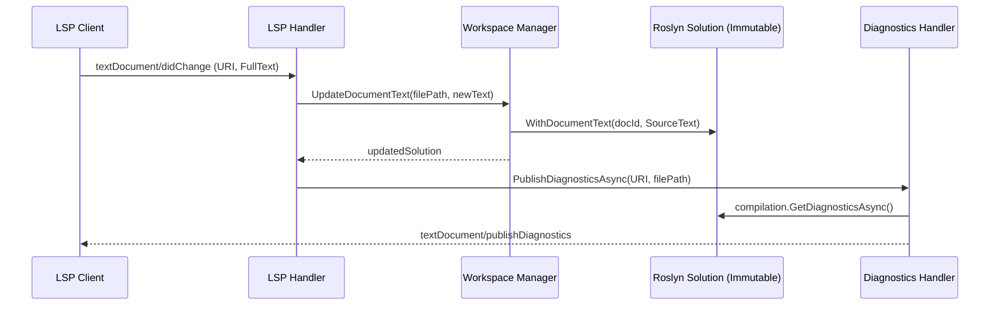

# Unity C# LSP Server Detailed Architecture & Design Specification

## 0. Project Overview & Positioning

### 0.1 Purpose
Build a fast, lightweight, and precise C# Language Server Protocol (LSP) server specifically tailored for Unity projects.
While leveraging the .NET SDK and Roslyn (`Microsoft.CodeAnalysis`) for core syntax and semantic analysis, it provides a workspace resolution layer that treats Unity-specific structures (`.asmdef`, UPM package resolution, conditional compilation symbols, Editor/Runtime configurations) as first-class citizens.

### 0.2 Background & Challenges of Existing Tools
Traditional C# language servers (OmniSharp, csharp-ls, Microsoft C# Dev Kit / Roslyn LSP) are designed around the standard MSBuild (`.sln` / `.csproj`) ecosystem. When applied to Unity projects, they encounter structural hurdles:

1. **Preprocessor Symbol Mismatches**:
   Symbols dynamically derived from `ProjectSettings/ProjectVersion.txt`, active platforms, or package defines (`UNITY_2022_3_OR_NEWER`, `UNITY_EDITOR`, etc.) are not resolved, causing `#if` directive blocks to be incorrectly grayed out or misidentified.
2. **Dependency on Unity Editor & File Lock Conflicts**:
   Newly created files or assembly references are not reflected until Unity regenerates `.csproj` files. Furthermore, while the Unity Editor compiles code, DLLs in `Library/ScriptAssemblies/` are locked, causing read exceptions in external LSP servers.
3. **Multi-Tiered Assembly Definition (`.asmdef`) Graph**:
   Unity-specific dependencies (GUID references, `versionDefines`, `defineConstraints`, `overrideReferences`) cannot be directly parsed by standard MSBuild tools, resulting in false unresolved reference errors.
4. **Missing Unity Idioms & False Diagnostics**:
   Unity lifecycle methods (`Awake`, `Start`, `Update`) are flagged as "unused private methods" (`IDE0051`), and `[SerializeField]` private fields are flagged as "never assigned" (`CS0649`).

### 0.3 Goals & Non-Goals

#### Goals
- **Autonomous Resolution without Unity Editor**: Open a Unity project directory and immediately resolve `.asmdef`, packages, and Managed DLLs without needing the Unity Editor to be running.
- **Fast Incremental Updates**: Use Roslyn's immutable solution data structure to respond to keystroke text edits in tens of milliseconds.
- **First-Class Unity Support**: Unity message completions (Magic Methods), suppression of false warnings on `[SerializeField]`, and seamless Editor/Runtime configuration awareness.
- **Cross-Platform Single Binary**: Run as a single, self-contained binary across Windows, macOS, and Linux editors (VS Code, Neovim, Zed, Helix, etc.).

#### Non-Goals (Initial Scope)
- Serialized data parsing for `.unity` scene or `.prefab` files.
- Non-C# languages (ShaderLab, HLSL, UXML, USS).
- Running full player builds (delegated to Unity Editor / CLI).

---

## 1. System Architecture

The architecture consists of four distinct layers:

```
[ Editors / AI Clients (VS Code / Neovim / Zed / OpenCode) ]
                          │  JSON-RPC (stdio / named pipe / socket)
                          ▼
┌─────────────────────────────────────────────────────────────────┐
│                     Unity C# LSP Server                         │
├─────────────────────────────────────────────────────────────────┤
│ 1. LSP Protocol Layer (StreamJsonRpc / LSP Protocol Models)     │
│    - JSON-RPC message dispatching                               │
│    - Lifecycle management (initialize, initialized, shutdown,   │
│      exit)                                                      │
│    - Concurrency control & CancellationToken propagation        │
├─────────────────────────────────────────────────────────────────┤
│ 2. Unity Workspace Engine                                       │
│    - Unity Editor & Managed DLL locator (Hub, path, env)        │
│    - Package resolver (manifest.json, PackageCache, git/local)  │
│    - Asmdef graph builder (.asmdef, GUID, constraints, defines) │
│    - File system watcher (monitor for new/deleted/modified cs)  │
├─────────────────────────────────────────────────────────────────┤
│ 3. Roslyn Compilation Core                                      │
│    - AdhocWorkspace / custom Solution manager                   │
│    - SourceText incremental synchronization                     │
│    - MetadataReference cache (Managed DLL, package DLL)         │
│    - Incremental compilation & diagnostics pipeline             │
├─────────────────────────────────────────────────────────────────┤
│ 4. Unity Semantic & Language Providers                          │
│    - Diagnostics provider (Roslyn diagnostics + suppressors)   │
│    - Hover & quick info provider (signatures + XML summaries)   │
│    - Completion provider (member lookup + MonoBehaviour message)│
│    - Definition / reference provider (cross-assembly AST walk)  │
│    - Implementation, document/workspace symbol providers        │
│    - Call hierarchy provider (incoming/outgoing calls)          │
└─────────────────────────────────────────────────────────────────┘
```

---

## 2. Unity Workspace Resolution Engine

### 2.1 Unity Editor & Managed DLL Discovery (`UnityInstallationLocator`)
To resolve core Unity APIs (`UnityEngine.dll`, `UnityEngine.CoreModule.dll`, `UnityEditor.dll`), the locator automatically discovers the matching Unity Editor:

1. **Unity Version Extraction**:
   - Parses `ProjectSettings/ProjectVersion.txt` using regex `m_EditorVersion:\s*([0-9a-zA-Z\.\-]+)`.
2. **Editor Search Priority**:
   - **Priority 1 (Explicit)**: `unity.editorPath` initialization option or `UNITY_EDITOR_PATH` environment variable.
   - **Priority 2 (Unity Hub Config)**:
     - Windows: `%APPDATA%/UnityHub/editors.json`
     - macOS: `~/Library/Application Support/UnityHub/editors.json`
     - Linux: `~/.config/UnityHub/editors.json`
   - **Priority 3 (Standard Install Locations)**:
     - Windows: `C:\Program Files\Unity\Hub\Editor\<version>\Editor\`
     - macOS: `/Applications/Unity/Hub/Editor/<version>/Unity.app/Contents/`
     - Linux: `~/Unity/Hub/Editor/<version>/Editor/`
   - **Priority 4 (In-Project Library Fallback)**:
     - `Library/ScriptAssemblies/` and `Library/PackageCache/`.
3. **Managed Assembly Collection**:
   - Runtime assemblies: `<EditorPath>/Data/Managed/UnityEngine/*.dll`
   - Editor assemblies: `<EditorPath>/Data/Managed/UnityEditor*.dll`

### 2.2 Package Resolution (`UnityPackageResolver`)
1. **Manifest Parsing**:
   - Reads `Packages/manifest.json` dependencies and `Packages/packages-lock.json` if available.
2. **Package Path Resolution**:
   - **Built-in Modules**: `com.unity.modules.*` in Editor `Data/Resources/PackageManager/BuiltInPackages/`.
   - **Registry / Git Packages**: `Library/PackageCache/<package-id>@<hash>/`.
   - **Local / Embedded Packages**: `Packages/<package-id>/` or `file:` relative paths.

### 2.3 Assembly Definition (`.asmdef`) Graph (`AsmdefGraphBuilder`)
Each `.asmdef` maps to a distinct Roslyn `ProjectInfo`:
- `name`: Unique assembly name (e.g., `Game.Runtime`).
- `references`: Target dependencies resolved by name or GUID (via `.asmdef.meta`).
- `autoReferenced`: Auto-referenced by root `Assembly-CSharp` when true.
- `includePlatforms` / `excludePlatforms`: Injects `UNITY_EDITOR` and `UnityEditor.dll` references when Editor platform is targeted.
- `versionDefines`: Dynamically injects compilation symbols when specific package version ranges match.
- `allowUnsafeCode`: Sets `CSharpCompilationOptions.AllowUnsafe`.

### 2.4 Preprocessor Symbol Generation (`DefineSymbolManager`)
Precomputes preprocessor symbols per assembly:
1. **Unity Version Symbols**:
   - e.g., `2022.3.20f1` yields `UNITY_2022`, `UNITY_2022_3`, `UNITY_2022_3_20`, `UNITY_2022_OR_NEWER`, `UNITY_2022_3_OR_NEWER`, etc.
2. **Platform Symbols**:
   - `UNITY_STANDALONE`, `UNITY_STANDALONE_WIN` / `_OSX` / `_LINUX`.
3. **Editor Symbols**:
   - `UNITY_EDITOR` for editor assemblies.
4. **Version Defines**:
   - Evaluates `versionDefines` expressions against installed packages.

---

## 3. Roslyn Workspace & Document Architecture

### 3.1 Workspace Model
- Uses an in-memory `AdhocWorkspace` directly hosting immutable `Solution` and `ProjectInfo` instances.
- Avoids MSBuild evaluation overhead and file system locks completely.

### 3.2 Synchronization & Diagnostic Cycle


---

## 4. Language Server Feature Implementations

| LSP Method | Description | Implementation Details |
| :--- | :--- | :--- |
| `initialize` | Capability handshake | Detects project root, instantiates `UnityWorkspaceManager` |
| `textDocument/didOpen` | File opened | Tracks in-memory document, publishes diagnostics |
| `textDocument/didChange` | Full text update | Applies `WithDocumentText`, triggers diagnostics |
| `textDocument/didClose` | File closed | Flushes dirty state, re-syncs with disk |
| `textDocument/publishDiagnostics` | Diagnostics | Compiles via Roslyn; suppresses `CS0649` on `[SerializeField]` |
| `textDocument/hover` | Hover tooltips | Resolves `ISymbol` at offset, formats signature and XML summary |
| `textDocument/definition` | Go to definition | Resolves declaration AST node, handles cross-asmdef jumps |
| `textDocument/completion` | Code completion | Member completions, scope lookup, and MonoBehaviour magic methods |
| `textDocument/references` | Find references | Solution-wide symbol search via `SymbolFinder` |
| `textDocument/implementation` | Go to implementation | `SymbolFinder.FindImplementationsAsync` for interfaces/overrides |
| `textDocument/documentSymbol` | Document outline | Hierarchical `DocumentSymbol` tree built from declared semantic symbols |
| `workspace/symbol` | Workspace symbols | Per-project `Compilation.GetSymbolsWithName` search (capped) |
| `textDocument/prepareCallHierarchy` | Call hierarchy root | Resolves the callable symbol at the cursor |
| `callHierarchy/incomingCalls` | Incoming calls | `SymbolFinder.FindCallersAsync` grouped by caller |
| `callHierarchy/outgoingCalls` | Outgoing calls | Semantic-model walk over invocation/object-creation expressions |
| `workspace/didChangeWatchedFiles` | File watcher | Adds/removes `.cs` files in compilation automatically |

---

## 5. Project Structure

```
UnityCSharpLSP/
├── src/
│   ├── UnityCSharpLSP.Server/              # Entry point CLI (stdio, options)
│   │   └── Program.cs
│   │
│   ├── UnityCSharpLSP.Protocol/            # LSP JSON-RPC handlers
│   │   ├── Handlers/
│   │   │   ├── TextDocumentSyncHandler.cs
│   │   │   ├── HoverHandler.cs
│   │   │   ├── DefinitionHandler.cs
│   │   │   ├── CompletionHandler.cs
│   │   │   ├── ReferencesHandler.cs
│   │   │   ├── ImplementationHandler.cs
│   │   │   ├── DocumentSymbolHandler.cs
│   │   │   ├── WorkspaceSymbolHandler.cs
│   │   │   ├── CallHierarchyHandler.cs
│   │   │   ├── DiagnosticsHandler.cs
│   │   │   └── WatchedFilesHandler.cs
│   │   ├── Models/
│   │   │   ├── CallHierarchy.cs
│   │   │   └── ExtendedServerCapabilities.cs
│   │   └── LspJsonRpcSession.cs
│   │
│   ├── UnityCSharpLSP.Workspace/           # Unity workspace engine & Roslyn host
│   │   ├── Defines/
│   │   │   └── DefineSymbolManager.cs
│   │   ├── Graph/
│   │   │   ├── AsmdefGraph.cs
│   │   │   └── AsmdefGraphBuilder.cs
│   │   ├── Locators/
│   │   │   ├── UnityInstallationLocator.cs
│   │   │   └── UnityPackageResolver.cs
│   │   ├── Models/
│   │   │   ├── AsmdefFile.cs
│   │   │   ├── UnityProjectInfo.cs
│   │   │   └── VersionDefine.cs
│   │   ├── UnityProjectLoader.cs
│   │   ├── UnityWorkspaceManager.cs
│   │   └── WorkspaceWatcher.cs
│   │
│   └── UnityCSharpLSP.Semantics/           # Unity-specific rules & analyzers
│       ├── Analyzers/
│       │   └── SerializeFieldSuppressor.cs
│       └── Features/
│           └── MonoBehaviourMessages.cs
│
├── tests/
│   ├── UnityCSharpLSP.Workspace.Tests/     # Workspace engine & Roslyn tests
│   └── UnityCSharpLSP.Protocol.Tests/      # End-to-end LSP protocol tests
│
└── DummyProject/                           # Unity test project with multiple asmdefs
    ├── Assets/
    ├── Packages/
    └── ProjectSettings/
```
