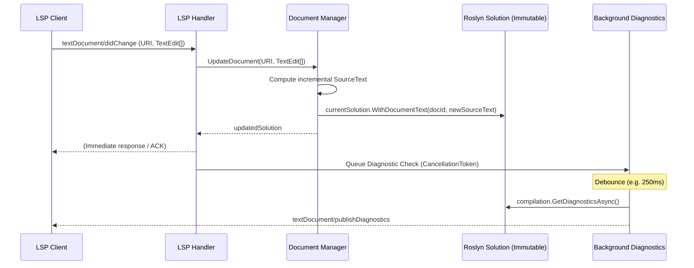

# Unity 専用 C# LSP サーバ 詳細設計書

## 0. プロジェクト概要と位置づけ

### 0.1 目的
Unity プロジェクトに特化した、高速かつ高精度な C# Language Server Protocol (LSP) サーバを構築する。
コアの構文解析・セマンティクス解析には .NET SDK / Roslyn (`Microsoft.CodeAnalysis`) を活用しつつ、Unity 特有のプロジェクト構造（`.asmdef`、パッケージ解決、プリプロセッサシンボル、Editor/Runtime環境）を第一級市民として扱うワークスペース解決層を提供する。

### 0.2 背景と既存ツールの課題
既存の汎用 C# 言語サーバ（OmniSharp, csharp-ls, Microsoft C# Dev Kit / Roslyn LSP）は、標準的な MSBuild (`.sln` / `.csproj`) エコシステムを前提に設計されている。Unity プロジェクトで利用する場合、以下の構造的課題に直面する：

1. **プリプロセッサシンボルの不整合**:
   `ProjectSettings/ProjectVersion.txt` やプラットフォーム、パッケージ定義から動的に導出されるシンボル（`UNITY_2022_3_OR_NEWER`, `UNITY_EDITOR`, パッケージ由来の定義等）が正しく反映されず、`#if` ディレクティブブロックがグレーアウトされたり誤判定される。
2. **Unity Editor への依存とファイルロック競合**:
   Unity が `.csproj` を再生成するまで新規ファイルやアセンブリ参照が反映されない。また、Unity Editor のコンパイル中に `Library/ScriptAssemblies/` の DLL がロックされ、LSP 側で読み取り例外が発生する。
3. **Assembly Definition (`.asmdef`) の多階層構造**:
   Unity 独自の依存関係（GUID参照、`versionDefines`、`defineConstraints`、`overrideReferences`）を直接解釈できないため、アセンブリ間の参照解決エラーが多発する。
4. **Unity 固有セマンティクスの欠落**:
   `MonoBehaviour` のライフサイクルメソッド（`Awake`, `Start`, `Update` 等）が「未使用メソッド」として警告される、`[SerializeField]` の private フィールドが「未使用フィールド」と誤判定されるなど、Unity のイディオムと衝突する。

### 0.3 ゴール & 非ゴール

#### ゴール
- **Unity Editor 非起動下での自律解決**: Unity Editor を起動していなくても、プロジェクトディレクトリを開くだけで `.asmdef`、パッケージ、Unity Managed DLL を特定し、エラーのない型補完・定義ジャンプ・診断を提供する。
- **高速なインクリメンタル更新**: Roslyn の不変データ構造（Immutable Solution）を活用し、キーストロークごとの差分更新を数十ミリ秒以内で応答する。
- **Unity 固有機能の第一級サポート**: Unity メッセージ補完（Magic Methods）、`[SerializeField]` に対する警告抑止、Editor/Runtime 切り替え。
- **クロスプラットフォーム対応**: Windows, macOS, Linux 上の主要エディタ（VS Code, Neovim, Emacs, Zed 等）で単一バイナリとして動作する。

#### 非ゴール (初期スコープ外)
- Unity のシーンファイル（`.unity`）やプレハブ（`.prefab`）のシリアライズデータ解析（将来的には検討）。
- C# 以外の言語（ShaderLab, HLSL, UXML, USS）の解析。
- フルビルドの実行（Unity のプレイヤービルドそのものは Unity Editor / CLI に委ねる）。

---

## 1. システム全体アーキテクチャ

システムは大きく4つのレイヤー（LSP Protocol Layer, Workspace Engine, Roslyn Semantic Core, Unity Feature Extensions）で構成される。

```
[ エディタ / クライアント (VS Code / Neovim / Zed / Emacs) ]
                          │  JSON-RPC (stdio / named pipe / socket)
                          ▼
┌─────────────────────────────────────────────────────────────────┐
│                     Unity C# LSP Server                         │
├─────────────────────────────────────────────────────────────────┤
│ 1. LSP Protocol Layer (StreamJsonRpc / LSP Protocol Models)     │
│    - JSON-RPC メッセージディスパッチ                             │
│    - ライフサイクル管理 (initialize, initialized, shutdown, exit) │
│    - リクエスト並行制御 & CancellationToken キャンセル伝播      │
├─────────────────────────────────────────────────────────────────┤
│ 2. Unity Workspace Engine                                       │
│    - Unity Editor & Managed DLL Locator (Hub, Path, Env)        │
│    - Package Resolver (manifest.json, PackageCache, Git/Local)  │
│    - Asmdef Graph Builder (.asmdef, GUID, Constraints, Defines) │
│    - File System Watcher (asmdef/manifest 変更検知, デバウンス) │
├─────────────────────────────────────────────────────────────────┤
│ 3. Roslyn Compilation Core                                      │
│    - AdhocWorkspace / Custom Solution Manager                   │
│    - SourceText 差分同期 (textDocument/didChange)               │
│    - MetadataReference キャッシュ (Managed DLL, Package DLL)     │
│    - Incremental Compilation & Diagnostics Pipeline             │
├─────────────────────────────────────────────────────────────────┤
│ 4. Unity Semantic & Language Providers                          │
│    - Diagnostics Provider (Roslyn Diagnostics + Unity Analyzer) │
│    - Hover & QuickInfo Provider (XML Doc + Unity Docs リンク)   │
│    - Completion Provider (Roslyn Lookup + MonoBehaviour Message)│
│    - Definition / Reference Provider (Source + Decompiled Meta) │
│    - CodeAction Provider (Missing SerializeField, Generate Msg) │
└─────────────────────────────────────────────────────────────────┘
```

---

## 2. Unity プロジェクト構造解析 & ワークスペース解決エンジン

本 LSP サーバのコア競争力となる、Unity 固有のワークスペース自動解決アルゴリズムの仕様。

### 2.1 Unity Editor & Managed DLL 探索 (`UnityInstallationLocator`)
Unity の標準ライブラリ（`UnityEngine.dll`, `UnityEngine.CoreModule.dll`, `UnityEditor.dll` など）を解決するため、使用されている Unity Editor のインストールパスを自動特定する。

1. **Unity バージョンの特定**:
   - `ProjectSettings/ProjectVersion.txt` を読み取り、正規表現 `m_EditorVersion:\s*([0-9a-zA-Z\.\-]+)` でバージョン文字列（例: `2022.3.20f1`）を取得。
2. **Editor インストールディレクトリの探索順序**:
   - **優先度 1 (明示設定)**: クライアント初期化オプション `unity.editorPath` または環境変数 `UNITY_EDITOR_PATH`。
   - **優先度 2 (Unity Hub 構成情報)**:
     - Windows: `%APPDATA%/UnityHub/editors.json`
     - macOS: `~/Library/Application Support/UnityHub/editors.json`
     - Linux: `~/.config/UnityHub/editors.json`
     `editors.json` 内から合致するバージョンキーのマウントパスを取得。
   - **優先度 3 (標準インストールパス走査)**:
     - Windows: `C:\Program Files\Unity\Hub\Editor\<version>\Editor\`
     - macOS: `/Applications/Unity/Hub/Editor/<version>/Unity.app/Contents/`
     - Linux: `~/Unity/Hub/Editor/<version>/Editor/`
   - **優先度 4 (プロジェクト内 Library フォールバック)**:
     - Editor が未検出の場合、`Library/ScriptAssemblies/` 内および `Library/PackageCache/` のキャッシュ DLL を探索。
3. **Managed DLL の収集**:
   - Runtime アセンブリ: `<EditorPath>/Data/Managed/UnityEngine/*.dll` および `<EditorPath>/Data/Managed/UnityEngine.dll`
   - Editor アセンブリ: `<EditorPath>/Data/Managed/UnityEditor.dll`, `<EditorPath>/Data/Managed/UnityEditor.CoreModule.dll`
   - System/BCL アセンブリ: `<EditorPath>/Data/NetCore/` または `<EditorPath>/Data/MonoBleedingEdge/lib/mono/4.7.1-api/` 等の BCL 参照。

### 2.2 パッケージ解決 (`UnityPackageResolver`)
1. **マニフェスト解析**:
   - `Packages/manifest.json` の `dependencies` をパース。
   - `Packages/packages-lock.json`（存在する場合）から厳密なバージョンと取得元（`hash`, `url`, `path`）を優先抽出。
2. **パッケージの所在解決**:
   - **Built-in モジュール**: `com.unity.modules.*` → Unity Editor の `Data/Resources/PackageManager/BuiltInPackages/`。
   - **Registry / Git パッケージ**: `Library/PackageCache/<package-id>@<hash>/`。
   - **Local (埋め込み) パッケージ**: `Packages/<package-id>/` または `file:` による相対パス先。
3. **パッケージ内アセンブリの抽出**:
   - パッケージフォルダ直下または配下の `.asmdef` を走査し、プロジェクト内アセンブリグラフへ統合。
   - プリコンパイル済み DLL（プラグイン）が存在する場合は `MetadataReference` に追加。

### 2.3 Assembly Definition (`.asmdef`) 解析 & 依存グラフ構築 (`AsmdefGraphBuilder`)

#### asmdef スキーマ解釈規則
各 `.asmdef` は Roslyn のひとつの `ProjectInfo` (Project) に対応する。
- `name`: プロジェクトの一意名（例: `Game.Runtime`）。
- `references`: 依存先アセンブリ。
  - 名前指定（例: `"Game.Data"`）
  - GUID 指定（例: `"GUID:0123456789abcdef0123456789abcdef"`）: 同ディレクトリまたは `Library/` の `.meta` ファイルを照合して名前解決。
- `autoReferenced`: `true` の場合、`.asmdef` を持たないコード（`Assembly-CSharp`）から自動的に参照される。
- `includePlatforms` / `excludePlatforms`: `"Editor"` が含まれる場合、`UnityEditor.dll` への参照および `UNITY_EDITOR` 定義を付与。
- `defineConstraints`: 指定されたシンボル（例: `ENABLE_INPUT_SYSTEM`）が現在のアセンブリ構成で有効でない場合、該当アセンブリをコンパイル対象から除外（または警告）。
- `versionDefines`: 特定パッケージのバージョン範囲に応じて、追加のプリプロセッサシンボルを動的注入する。
- `overrideReferences` & `precompiledReferences`: プロジェクト外の特定 DLL のみを明示参照する設定。
- `allowUnsafeCode`: Roslyn の `CompilationOptions.AllowUnsafe` に反映。
- `noEngineReferences`: `true` の場合、`UnityEngine` / `UnityEditor` の参照を除外。

#### フォルダとソースコードの紐付け
- `.asmdef` が配置されたディレクトリ配下の全 `.cs` ファイルは、そのアセンブリに所属する。
- サブディレクトリに別の `.asmdef` がある場合、そのサブディレクトリ配下は子アセンブリに専属し、親アセンブリからは除外される。
- いかなる `.asmdef` にも属さない `.cs` ファイル：
  - パスに `Editor/` を含む場合: デフォルトの `Assembly-CSharp-Editor` プロジェクトへ集約。
  - それ以外: デフォルトの `Assembly-CSharp` プロジェクトへ集約（`Assembly-CSharp-Editor` は `Assembly-CSharp` を自動参照）。

### 2.4 プリプロセッサシンボル自動生成規則 (`DefineSymbolManager`)
各コンパイル単位に設定するプリプロセッサシンボル（Conditional Compilation Symbols）は以下を合成して決定する：

1. **Unity バージョンシンボル**:
   - 例: `2022.3.20f1` の場合:
     - `UNITY_2022`, `UNITY_2022_3`, `UNITY_2022_3_20`, `UNITY_2022_3_OR_NEWER`, `UNITY_2022_OR_NEWER`, `UNITY_2021_OR_NEWER`, `UNITY_2020_OR_NEWER` 等を自動計算生成。
2. **プラットフォームシンボル**:
   - デフォルト: `UNITY_STANDALONE`, `UNITY_STANDALONE_WIN` (OSに応じて初期設定、LSP設定でターゲットプラットフォーム変更可能)。
3. **Editor シンボル**:
   - Editor アセンブリ (`Assembly-CSharp-Editor`, Editor asmdef) またはアクティブ構成において `UNITY_EDITOR` を定義。
4. **パッケージ・機能シンボル**:
   - `manifest.json` の導入状況および asmdef の `versionDefines` から `ENABLE_INPUT_SYSTEM`, `ENABLE_UGUI` などを算出。
5. **ユーザー定義シンボル**:
   - `ProjectSettings/ProjectSettings.asset` 内の `scriptingDefineSymbols`（または `.csproj` / 設定ファイル）からパース。

---

## 3. Roslyn Workspace & ドキュメント管理アーキテクチャ

### 3.1 ワークスペースモデルの選択
- **採用方針**: 独自の `Workspace` 実装（内部で `Solution` と `ProjectInfo` を直接管理するマネージャ）。
- **理由**: MSBuildWorkspace は `.sln` / `.csproj` がディスク上に存在し、かつ MSBuild が正しくビルド評価できる環境を前提とするため、Unity がプロジェクトファイルを生成していないタイミングや、環境差分で容易に破損する。自前の Workspace マネージャであれば、ディスク上の `.asmdef` と `.cs` から直接 Roslyn の `ProjectInfo` 群を瞬時にインメモリ構築できる。

### 3.2 不変 Solution とインクリメンタル更新サイクル
Roslyn の `Solution`、`Project`、`Document` はイミュータブル（不変データ構造）である。



1. **ドキュメントオープン (`textDocument/didOpen`)**:
   - ディスクのパスから所属する `ProjectId` を逆引き。
   - `DocumentId` を生成し、初期 `SourceText` で `Solution` を更新。
2. **差分更新 (`textDocument/didChange`)**:
   - フルテキスト置換または Range 差分適用により、既存の `SourceText.WithChanges()` を適用。
   - `currentSolution = currentSolution.WithDocumentText(docId, newText)` で新しい Solution インスタンスを生成（旧ツリーは共有されるためメモリ・CPU コストは極小）。
   - 保留中の未完了解析タスクを `CancellationTokenSource.Cancel()` で中断。
3. **ファイル監視 (`workspace/didChangeWatchedFiles` または internal FileSystemWatcher)**:
   - 新規 `.cs` 追加 / 削除: 該当アセンブリの `ProjectInfo` に Document を追加/削除。
   - `.asmdef` / `manifest.json` 変更: 依存関係グラフを再計算し、影響を受ける `ProjectInfo` のみを更新。

---

## 4. LSP 機能仕様 & Unity 特化言語プロバイダ

### 4.1 コア LSP メソッド対応方針

| LSP Method | 説明 | Roslyn 実装アプローチ | Unity 特化付加価値 |
| :--- | :--- | :--- | :--- |
| `initialize` | 初期化・機能宣言 | Capabilities の折衝、Unity プロジェクトルート確定 | Unity バージョン・asmdef 検出結果をログ通知 |
| `textDocument/didOpen` | ファイルオープン | Workspace に追跡ドキュメントとして登録 | - |
| `textDocument/didChange` | インクリメンタル変更 | `SourceText.WithChanges` による高速差分反映 | - |
| `textDocument/didClose` | ファイルクローズ | メモリ上の未保存状態破棄（ディスク同期） | - |
| `textDocument/publishDiagnostics` | 診断 (エラー/警告) | `compilation.GetDiagnosticsAsync()` | Unity 固有警告抑止 & 独自アナライザ注入 |
| `textDocument/hover` | ホバー情報 | `GetSemanticModel` -> `GetSymbolInfo` -> XML Doc | Unity Scripting Reference への直リンク付与 |
| `textDocument/completion` | コード補完 | `SemanticModel.LookupSymbols` / SyntaxContext | `MonoBehaviour` メッセージ補完、Tag/Layer 補完 |
| `textDocument/definition` | 定義ジャンプ | `Symbol.Locations` | ソースのない Unity Managed DLL からの逆コンパイル |
| `textDocument/references` | 参照箇所の検索 | `SymbolFinder.FindReferencesAsync` | インスペクタ参照可能性の提示 |
| `textDocument/documentSymbol`| アウトライン / シンボル | SyntaxNode 走査 (`BaseMethodDeclarationSyntax` 等) | Unity ライフサイクルメソッドにバッジ表示 |
| `textDocument/codeAction` | クイックフィックス | `CodeFixProvider` / テンプレート挿入 | `[SerializeField]` 付与、未実装イベント関数生成 |
| `textDocument/formatting` | ドキュメントフォーマット | `Formatter.FormatAsync` (Roslyn 内蔵) | `.editorconfig` 準拠 |

### 4.2 Unity 固有プロバイダの詳細

#### 1. MonoBehaviour Magic Methods 補完
- **トリガー**: `MonoBehaviour` または `NetworkBehaviour` を継承するクラス定義のブロック内で `void` またはメソッド名を入力。
- **機能**:
  - `Awake()`, `Start()`, `Update()`, `FixedUpdate()`, `LateUpdate()`, `OnEnable()`, `OnDisable()`, `OnDestroy()`, `OnCollisionEnter(Collision collision)`, `OnTriggerEnter(Collider other)` などのシグネチャをテンプレート補完。
  - コルーチン対応（`IEnumerator Start()` 等）もサポート。
  - XML ドキュメントコメント（実行タイミング、フレームレートとの関係など）を補完プレビューに表示。

#### 2. Unity 固有アナライザ & 診断サプレッサー
標準 Roslyn アナライザの誤判定を抑止し、Unity 固有のベストプラクティスを診断：
- **警告サプレッサー (Diagnostic Suppressors)**:
  - `CS0649` ("Field is never assigned to..."): `[SerializeField]` または `[field: SerializeField]` が付与されたフィールドでは抑止。
  - `IDE0051` / `CS0169` ("Private member is unused"): `Awake`, `Start`, `Update` などの Unity イベント関数では抑止。
- **Unity 独自アナライザ**:
  - `UNITY0001`: `MonoBehaviour` クラスでパラメータなしコンストラクタを定義している（`Awake` / `Start` を使うべき）。
  - `UNITY0002`: `[SerializeField]` が private 以外の public フィールド、またはシリアライズ不能型に付与されている。
  - `UNITY0003`: `Update()` / `FixedUpdate()` 内での `GetComponent()` や `Camera.main`、文字列連結によるアロケーションを警告。
  - `UNITY0004`: バックグラウンドスレッド（`Task.Run` 等）から `UnityEngine` のメインスレッド限定 API を呼び出している。

#### 3. メタデータ逆コンパイルジャンプ (`Decompiled Metadata Provider`)
Unity エンジン本体のコード（`UnityEngine.Vector3`, `GameObject` など）への定義ジャンプ時：
- ソースコードが存在しない場合、Roslyn の `ISymbol` からシグネチャおよび XML ドキュメントコメントを抽出した擬似 C# ファイル（Metadata As Source）をオンデマンド生成し、URI `omnisharp-metadata://...` または仮想ファイルパスとしてエディタに返す。

---

## 5. 並行制御・パフォーマンス & 障害対策設計

### 5.1 並行性とスレッドモデル
LSP は非同期かつ多重リクエストが発生するプロトコルである。
- **リクエスト処理パイプライン**:
  - 変更通知 (`didChange`) は逐次キュー（FIFO）で即時 Solution を更新。
  - 参照検索・診断などの重い処理は `Task.Run` のワーカースレッドプールで実行。
- **協調的キャンセル (`CancellationToken`)**:
  - 各リクエストにはクライアントからの `$/cancelRequest` と、新たなテキスト編集発生時に発行されるトークンを紐付け。
  - セマンティクス解析・AST 走査のループ各所で `cancellationToken.ThrowIfCancellationRequested()` を呼び、無駄な CPU 消費を即座に破棄。

### 5.2 大規模プロジェクト向け遅延解決 (Lazy Resolution)
1000 以上の `.cs` ファイルや 100 以上の `.asmdef` を持つプロジェクトにおいて、起動時間を最短化する戦略：
1. **フェーズ 1 (初期化時: < 1秒)**:
   - ディレクトリ走査による `.asmdef` ツリーのパースと `ProjectInfo` スケルトンの作成。
   - Unity Managed DLL のロード。
2. **フェーズ 2 (didOpen 時の優先ロード)**:
   - ユーザーが開いたファイルとその所属アセンブリ、およびその直接の依存アセンブリのみ優先して `Compilation` を構築・キャッシュ。
3. **フェーズ 3 (バックグラウンドアイドル時)**:
   - 残りのアセンブリをバックグラウンドで段階的に解析・キャッシュ構築。

### 5.3 Unity Editor ファイルロック競合対策
Unity Editor がコードをコンパイルする際、`Library/ScriptAssemblies/` やキャッシュファイルが排他ロックされる場合がある。
- **Shadow Copy / メモリストリーム読み込み**:
  - アセンブリ DLL を読み込む際は `AssemblyMetadata.CreateFromImage(File.ReadAllBytes(path))` または `FileShare.ReadWrite` を指定して開き、ロックを回避。
- **Exponential Backoff リトライ**:
  - `IOException` が発生した場合は 50ms, 100ms, 200ms と指数バックオフで最大 3 回リトライ。

---

## 6. 技術スタック & プロジェクト構成

### 6.1 選定技術
- **言語・ターゲットランタイム**: C# 12 / .NET 8 LTS (または .NET 9)
- **コア解析エンジン**:
  - `Microsoft.CodeAnalysis.CSharp` (最新安定版 4.8+)
  - `Microsoft.CodeAnalysis.CSharp.Workspaces`
  - `Microsoft.CodeAnalysis.Analyzers`
- **JSON-RPC / LSP プロトコル基盤**:
  - `StreamJsonRpc` + `Microsoft.VisualStudio.LanguageServer.Protocol`
  - *(選定理由: OmniSharp.Extensions.LanguageServer は更新頻度が落ちており、最新 .NET / VS Code LSP 仕様追従に難がある一方、StreamJsonRpc は Microsoft 公式が VS / VS Code 拡張バックエンドとして極めて高いパフォーマンスと安定性を実証しているため)*
- **CLI & ホスティング**:
  - `System.CommandLine`
  - `Microsoft.Extensions.Logging`
  - `System.IO.Hashing` / `System.Text.Json`

### 6.2 ソリューション & プロジェクト構成
```
UnityCSharpLSP/
├── src/
│   ├── UnityCSharpLSP.Server/              # エントリポイント (CLI, stdio/TCP ホスト)
│   │   ├── Program.cs
│   │   └── ServerHost.cs
│   │
│   ├── UnityCSharpLSP.Protocol/            # LSP ハンドラ実装
│   │   ├── Handlers/
│   │   │   ├── TextDocumentSyncHandler.cs
│   │   │   ├── CompletionHandler.cs
│   │   │   ├── HoverHandler.cs
│   │   │   ├── DefinitionHandler.cs
│   │   │   └── DiagnosticsHandler.cs
│   │   └── LspJsonRpcSession.cs
│   │
│   ├── UnityCSharpLSP.Workspace/           # Unity ワークスペース解決エンジン
│   │   ├── Models/
│   │   │   ├── AsmdefFile.cs
│   │   │   └── UnityProjectInfo.cs
│   │   ├── Locators/
│   │   │   ├── UnityInstallationLocator.cs
│   │   │   └── UnityPackageResolver.cs
│   │   ├── Graph/
│   │   │   └── AsmdefGraphBuilder.cs
│   │   ├── Defines/
│   │   │   └── DefineSymbolManager.cs
│   │   └── UnityWorkspaceManager.cs        # Roslyn AdhocWorkspace 統括
│   │
│   └── UnityCSharpLSP.Semantics/           # Unity 特化セマンティクス & アナライザ
│       ├── Analyzers/
│       │   ├── SerializeFieldSuppressor.cs
│       │   └── UnityLifecycleAnalyzer.cs
│       └── Features/
│           ├── MonoBehaviourCompletionProvider.cs
│           └── MetadataDecompilerProvider.cs
│
├── tests/
│   ├── UnityCSharpLSP.Workspace.Tests/     # asmdef パース、パッケージ解決のテスト
│   ├── UnityCSharpLSP.Protocol.Tests/      # LSP プロトコル通信テスト
│   └── UnityCSharpLSP.IntegrationTests/    # DummyProject を用いた E2E テスト
│
└── DummyProject/                           # テスト検証用 Unity プロジェクト
    ├── Assets/
    ├── Packages/
    └── ProjectSettings/
```

---

## 7. 実装ロードマップ & MVP マイルストーン

手戻りを防ぎ、最小構成から段階的に動作確認を行うための4段階計画。

```
[Phase 1: Minimal LSP Spine]
  - stdio JSON-RPC 通信 (StreamJsonRpc)
  - initialize, didOpen, didChange, didClose
  - 固定 DLL による Roslyn 単一 Compilation 構築
  - publishDiagnostics (基礎)
        │
        ▼
[Phase 2: Unity Workspace Engine (Core)]
  - ProjectVersion.txt パース & Unity Editor インストールパス探索
  - asmdef の走査とグラフ構築 (GUID 解決含む)
  - Packages (manifest.json, Library/PackageCache) 解決
  - プロジェクト全体の Roslyn AdhocWorkspace 構築
        │
        ▼
[Phase 3: Core IDE Features]
  - Definition (定義ジャンプ) & Hover (ホバー情報 + ドキュメント)
  - Completion (Roslyn 補完統合)
  - 差分編集の高速インクリメンタル同期
  - DummyProject でのエラーゼロ検証
        │
        ▼
[Phase 4: Unity-Specific Superpowers & Packaging]
  - MonoBehaviour イベント関数補完
  - [SerializeField] 誤診断抑止サプレッサー
  - 単一実行ファイル (`dotnet publish -p:PublishSingleFile=true`) 出力
  - VS Code 拡張連携ガイド
```

### Phase 1: Minimal LSP Spine (最小動作確認)
- 目標: エディタから LSP サーバとして認識され、単一の `.cs` ファイルに対して Roslyn のコンパイルエラーがエディタ上に赤波線で表示される。
- 検証: `DummyProject/Assets/Scripts/Data/GameConfig.cs` を直接開き、意図的に構文エラーを入れて診断が返ることを確認。

### Phase 2: Unity Workspace Engine (自律解決)
- 目標: Unity Editor を起動していなくても、Unity プロジェクトを開くだけで全 `.asmdef`、パッケージ、Managed DLL が正しくリンクされ、プロジェクト全体で未解決参照エラーがゼロになる。
- 検証: `DummyProject` において、`Game.Runtime` -> `Game.Data` への参照が正しく通る。

### Phase 3: Core Language Features (実用化)
- 目標: ホバー、定義ジャンプ、シンボル検索、コード補完が快適なレスポンスで動作する。
- 検証: Neovim または VS Code から接続し、`ScriptableObject` や `SerializeField` の型情報や定義元へ飛べることを確認。

### Phase 4: Unity Superpowers & 単一バイナリ配布
- 目標: Unity 開発者にとって OmniSharp より圧倒的に快適な環境を実現し、単一バイナリで配布可能にする。
- 検証: プラットフォーム別のバイナリビルド作成とテストスイートの完走。
