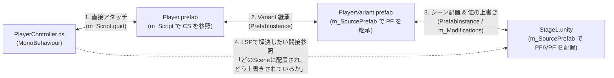
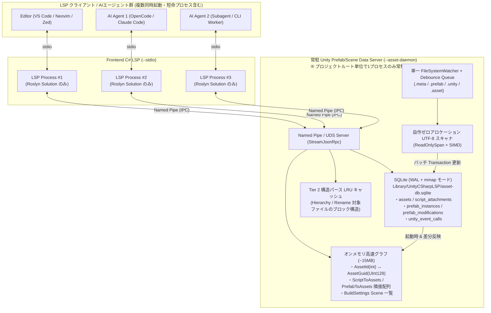
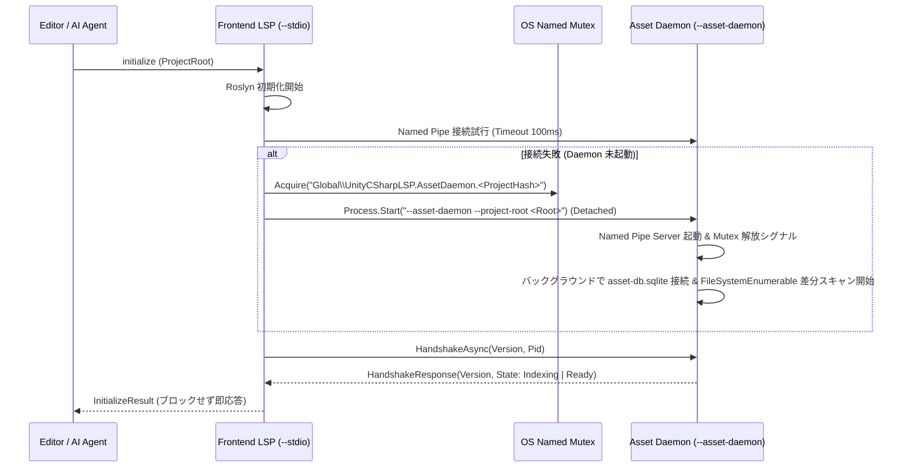

# Unity Prefab / Scene 常駐データサーバ & C# LSP 統合設計書

本ドキュメントは、数万個の `.prefab` / `.unity`（Scene）を抱える大規模Unityプロジェクトにおいて、C# LSP（`UnityCSharpLSP`）からPrefabおよびSceneファイルを高速・省メモリかつ双方向に解釈・操作するためのアーキテクチャ設計を定義します。

> 関連ドキュメント:
> - 全体アーキテクチャ: [doc/design.md](design.md)

---

## 1. 背景・目的と解決すべき課題

### 1.1 実現したいユースケース（3段階の深さ）

| レベル | 解釈対象 | 実現するLSP / AIエージェント機能 |
| :--- | :--- | :--- |
| **Lv.1: スクリプト参照 & 配置グラフ** | `m_Script` (`guid`)、`PrefabInstance` (`m_SourcePrefab`) | ・`MonoBehaviour` / `ScriptableObject` クラスの `Find References` / `CodeLens` で、直接アタッチされた `.prefab` / `.unity` だけでなく **そのPrefabを配置している `.unity` (Scene) や親Prefab（間接参照）** まで列挙<br>・YAML内の `guid` から `.cs` や別アセットへ `Go to Definition` / `DocumentLink` / `Hover` |
| **Lv.2: フィールド・イベント・Variant結線** | シリアライズフィールド、`UnityEvent` (`m_PersistentCalls`)、`m_Modifications` (`propertyPath`) | ・`[SerializeField]` フィールドの `Find References` で、値が設定・オーバーライドされている Prefab / Scene 箇所へジャンプ<br>・C# フィールドやメソッドの `Rename` 時に `.prefab` / `.unity` 内のYAMLキー名・`propertyPath`・`m_MethodName` を一括更新（または `[FormerlySerializedAs]` を自動付与）<br>・`UnityEvent` から呼ばれているC#メソッドの参照検出と未使用警告 (`IDE0051`) の抑制 |
| **Lv.3: Hierarchy構造・Scene検証・横断診断** | `GameObject` ↔ `Transform` ↔ `Component` の `fileID` グラフ、`SceneRoots`、`EditorBuildSettings.asset` | ・`.unity` / `.prefab` の `DocumentSymbol`（UnityのHierarchyウィンドウと同等の階層ツリー表示）<br>・C# 内の `SceneManager.LoadScene("...")` に対するシーン名補完・定義ジャンプ・未登録シーン警告<br>・Missing Script / Orphaned Property（C#側で消えたフィールドの残骸）等の横断 `Diagnostics`<br>・AIエージェント向けのコンパクトな Scene / Prefab Hierarchy 抽出コマンド |

### 1.2 Scene (`.unity`) と Prefab (`.prefab`) の間接参照問題

`.unity` シーン内に `Player.prefab` が配置されている場合、`Stage1.unity` のYAML内には `PlayerController.cs` のGUID（`m_Script`）は**直接出現しません**（`Player.prefab` のGUIDのみが `PrefabInstance` ブロックの `m_SourcePrefab` として記録される）。



したがって、単なる文字列検索ではなく **`Script ↔ Prefab ↔ Nested/Variant Prefab ↔ Scene` の有向グラフとオーバーライド関係** をデータベース化して管理する必要があります。

### 1.3 大規模プロジェクト制約とマルチクライアント問題

1. **数万個の `.prefab` / `.unity` と十数万個の `.meta`**:
   * 商用規模のUnityプロジェクトでは、アセット総数が5万〜10万ファイル、YAML総容量が数GB〜数十GBに達します。
   * 起動時の全ファイル `Open` や、行単位の `string` 生成（`StreamReader.ReadLine`）・正規表現・フルYAMLパース、および行番号やフィールド名の全件オンメモリ（GCヒープ）保持は、**ディスクI/O飽和・数GBのメモリ消費・LSP無応答**を引き起こします。
2. **複数のエディタ・AIエージェントによるLSP多重起動**:
   * VS Code / Neovim 等のエディタに加え、OpenCode・Claude Code・並列サブエージェント（ワーカー）がそれぞれ `UnityCSharpLSP.Server --stdio` を起動・終了します。
   * 各 `--stdio` プロセスが個別に数万アセットのインデックスと `FileSystemWatcher` を持つと、メモリ消費とファイル監視コストがプロセス数倍に膨れ上がります。

---

## 2. 分離アーキテクチャ全体像（Frontend LSP + 常駐データサーバ）

上記課題を解決するため、**フロントエンド C# LSP (`--stdio`)** と、プロジェクト単位でマシン上に1プロセスだけ常駐する **Unity Prefab/Scene データサーバ (`--asset-daemon`)** に分離します。

配布の容易さ（Single Binary の利点）を維持するため、同一バイナリ (`UnityCSharpLSP.Server`) の動作モード切り替えとして実装し、フロントエンドLSP起動時にデータサーバが未起動であれば透過的に自動スポーンします。



### 2.1 責務の分担

| コンポーネント | 責務 | 持たないもの |
| :--- | :--- | :--- |
| **Frontend C# LSP (`--stdio`)** | ・Roslyn `AdhocWorkspace` とC#構文・意味解析 (`ISymbol`)<br>・C#シンボルと `(ScriptGuid, MemberName, MemberKind)` の相互変換<br>・Roslyn結果とデータサーバ結果のマージ<br>・エディタとのLSP JSON-RPC通信 | ・`.prefab` / `.unity` のスキャン処理<br>・SQLite コネクションやアセット全体のGUID辞書<br>・`.prefab` / `.unity` 用の `FileSystemWatcher` |
| **常駐データサーバ (`--asset-daemon`)** | ・SQLite (`asset-db.sqlite`) のSingle-Writer管理とクエリ実行<br>・`CodeLens` 用の軽量オンメモリ隣接グラフ保持<br>・単一の `FileSystemWatcher` と変更デバウンス処理<br>・ゼロアロケーション UTF-8 スキャナによる高速インデックス構築<br>・Hierarchy取得・Rename時のみ対象ファイルを部分ブロックパース | ・Roslyn Workspace / C# コンパイルモデル（メモリ節約のため一切ロードしない） |

---

## 3. データベース選定とハイブリッドストレージ設計

### 3.1 なぜ「SQLite (WAL + mmap) ＋ オンメモリ隣接リスト」なのか

Unity エディタ本体（AssetDatabase v2 / Unity Search）と同様に、数万アセットのメタデータ・依存関係・プロパティオーバーライドを管理するには組み込みデータベースが不可欠です。常駐データサーバは **「1プロジェクトにつき1プロセスが独占書き込み（Single Writer）」** という特性を持つため、以下の比較から **`Microsoft.Data.Sqlite`（WAL + mmap モード）** を採用します。

| 選択肢 | 評価 | 理由 |
| :--- | :--- | :--- |
| **SQLite (`Microsoft.Data.Sqlite`)**<br>**＋ オンメモリ隣接配列** | **◎ 採用** | ・**1ファイル変更時の差分更新が極小**: `DELETE WHERE asset_id = ?` + `INSERT` のトランザクションが1〜2msで完了し、クラッシュ耐性（WAL）も完璧。<br>・**GCヒープ消費ゼロ**: 数百万行に及ぶ `m_Modifications`（オーバーライド）や `UnityEvent` 呼び出し情報をディスク＋OSのMMapページキャッシュに逃がせるため、C#プロセスのRAMが肥大化しない。<br>・**SQL JOIN による複雑な間接参照解決**: 「Prefab上のコンポーネントの特定フィールドが、どのSceneの `PrefabInstance` で上書きされているか」をインデックス付きJOINで1ms未満で検索可能。<br>・`sqlite3` CLIで開発中に直接テーブルを検査・デバッグできる。 |
| **完全自作バイナリ (`.bin`)** | **× 不採用** | ・1ファイル保存時の部分更新（WALや空き領域管理）や、Lv.2以降の複合インデックス（`target_guid + target_fid + field_name`）を自前実装すると、保守困難な自作RDBMSの再発明になる。 |
| **LMDB (`LightningDB`)** | **× 不採用** | ・Unity本体の `SourceAssetDB` が採用しているKVストアだが、セカンダリインデックスやJOINがなく、Windowsで事前指定した `MapSize`（例: 1GB）のファイル領域を即座に確保してしまう問題がある。 |
| **Pure C# DB (`LiteDB` 等)** | **× 不採用** | ・10万件規模のバルク挿入やBSONシリアライズが遅く、ロック競合やファイル肥大化のリスクがある。 |

> **Single-File Binary 配布との両立**:
> `Microsoft.Data.Sqlite` が依存するネイティブ `e_sqlite3`（約1.5MB）は、.NET の `PublishSingleFile=true` + `IncludeNativeLibrariesForSelfExtract=true` により単一実行ファイル内に自動バンドルされます。

### 3.2 SQLite スキーマ定義 (`Library/UnityCSharpLSP/asset-db.sqlite`)

GUID は 32文字の `TEXT`（32バイト＋エンコーディング負荷）ではなく、**`BLOB(16)`（16バイト `UInt128` バイナリ）** として格納し、B-Tree インデックスのサイズを半減・比較を高速化します。

```sql
PRAGMA journal_mode = WAL;
PRAGMA synchronous = NORMAL;
PRAGMA temp_store = MEMORY;
PRAGMA mmap_size = 268435456; -- 256MB mmap により OS ページキャッシュからゼロコピー読み取り

-- 1. アセット基本テーブル (.meta と本体ファイルのメタデータ)
CREATE TABLE assets (
    asset_id        INTEGER PRIMARY KEY,
    guid            BLOB(16) NOT NULL UNIQUE,   -- 16-byte UInt128
    rel_path        TEXT NOT NULL UNIQUE,       -- "Assets/Prefabs/Player.prefab"
    asset_kind      INTEGER NOT NULL,           -- 1:CS, 2:Prefab, 3:Scene, 4:ScriptableObject, 5:Other
    meta_mtime      INTEGER NOT NULL,           -- .meta の LastWriteTimeUtc.Ticks
    asset_mtime     INTEGER NOT NULL,           -- 本体ファイルの LastWriteTimeUtc.Ticks
    asset_size      INTEGER NOT NULL            -- 本体ファイルの FileSize
);

-- 2. コンポーネント (MonoBehaviour / ScriptableObject) アタッチテーブル (Lv.1)
CREATE TABLE script_attachments (
    asset_id         INTEGER NOT NULL,
    component_fid    INTEGER NOT NULL,          -- YAML 内の --- !u!114 &<fileID>
    game_object_fid  INTEGER NOT NULL,          -- m_GameObject: {fileID: ...}
    game_object_name TEXT,                      -- 所属 GameObject の m_Name
    script_guid      BLOB(16) NOT NULL,         -- m_Script の GUID
    line_number      INTEGER NOT NULL,          -- m_Script: 行の 0-based 行番号
    PRIMARY KEY (asset_id, component_fid)
) WITHOUT ROWID;
CREATE INDEX idx_script_attachments_guid ON script_attachments(script_guid);

-- 3. PrefabInstance 配置テーブル (Lv.1 間接参照: Scene配置 / Nested Prefab / Prefab Variant)
CREATE TABLE prefab_instances (
    asset_id            INTEGER NOT NULL,       -- 配置先の Scene または 親 Prefab の asset_id
    prefab_instance_fid INTEGER NOT NULL,       -- YAML 内の --- !u!1001 &<fileID>
    source_prefab_guid  BLOB(16) NOT NULL,      -- m_SourcePrefab の GUID
    line_number         INTEGER NOT NULL,       -- m_SourcePrefab: 行の 0-based 行番号
    PRIMARY KEY (asset_id, prefab_instance_fid)
) WITHOUT ROWID;
CREATE INDEX idx_prefab_instances_source ON prefab_instances(source_prefab_guid);

-- 4. Prefab Modification (オーバーライド) テーブル (Lv.2)
-- Scene や Prefab Variant 上で上書きされた propertyPath を記録
CREATE TABLE prefab_modifications (
    asset_id            INTEGER NOT NULL,
    prefab_instance_fid INTEGER NOT NULL,
    target_guid         BLOB(16) NOT NULL,      -- target.guid (元 Prefab の GUID)
    target_fid          INTEGER NOT NULL,       -- target.fileID (元 Prefab 内の Component/GO fileID)
    root_field_name     TEXT NOT NULL,          -- propertyPath の先頭識別子 ("_moveSpeed.x" -> "_moveSpeed")
    property_path       TEXT NOT NULL,          -- 完全な propertyPath
    line_number         INTEGER NOT NULL        -- propertyPath: 行の 0-based 行番号
);
CREATE INDEX idx_modifications_target ON prefab_modifications(target_guid, target_fid, root_field_name);
CREATE INDEX idx_modifications_asset ON prefab_modifications(asset_id);

-- 5. UnityEvent メソッド呼び出しテーブル (Lv.2)
CREATE TABLE unity_event_calls (
    asset_id        INTEGER NOT NULL,
    component_fid   INTEGER NOT NULL,
    target_guid     BLOB(16),                   -- 外部アセット参照時の GUID (同一ファイル内なら NULL)
    target_fid      INTEGER NOT NULL,           -- m_Target の fileID (Component または GameObject)
    method_name     TEXT NOT NULL,              -- m_MethodName の値
    line_number     INTEGER NOT NULL            -- m_MethodName: 行の 0-based 行番号
);
CREATE INDEX idx_unity_event_method ON unity_event_calls(method_name);
CREATE INDEX idx_unity_event_asset ON unity_event_calls(asset_id);

-- 6. シリアライズフィールド直接定義テーブル (Lv.2: MonoBehaviour 直下のカスタムフィールド行)
CREATE TABLE serialized_fields (
    asset_id        INTEGER NOT NULL,
    component_fid   INTEGER NOT NULL,
    field_name      TEXT NOT NULL,              -- YAML キー名 ("_moveSpeed")
    ref_guid        BLOB(16),                   -- フィールド値が {fileID: ..., guid: ...} の場合の参照先 GUID
    ref_fid         INTEGER,                    -- フィールド値が {fileID: ...} の場合の fileID
    line_number     INTEGER NOT NULL,
    PRIMARY KEY (asset_id, component_fid, field_name)
) WITHOUT ROWID;
CREATE INDEX idx_serialized_fields_ref_guid ON serialized_fields(ref_guid) WHERE ref_guid IS NOT NULL;
```

### 3.3 オンメモリ高速グラフ（C# 常駐RAMキャッシュ）

SQLite だけでも 1ms 以下で検索できますが、`textDocument/codeLens` のように「1つの `.cs` ファイル内の複数クラスに対して毎回トランジティブ参照数を数える」処理は、SQLite の `assets` / `script_attachments` / `prefab_instances` から起動時に以下の軽量辞書をオンメモリ（約10〜20MB）へ投影しておくことで **0.05ms（I/Oゼロ・SQL発行ゼロ）** で応答させます。

* `GuidToAssetId: Dictionary<AssetGuid, int>`
* `ScriptToDirectAssets: Dictionary<AssetGuid, int[]>`
* `PrefabToParentAssets: Dictionary<AssetGuid, int[]>`

---

## 4. 高速スキャンとクエリ実行フロー

### 4.1 起動時のゼロ FileOpen 差分検出 (`FileSystemEnumerable`)

Windows NTFS 等では、10万個のファイルに対して `File.Open` を呼ぶだけで十数秒を要します。

1. 起動時、まず SQLite の `assets` テーブル全行（`rel_path`, `meta_mtime`, `asset_mtime`, `asset_size`）をメモリ上の辞書に読み込みます（5万行で数十ms）。
2. .NET の `FileSystemEnumerable<T>` を用いて `Assets/` とローカル `Packages/` を走査します。OSのディレクトリエントリ（`FindFirstFileEx` / `stat`）から **ファイルを一切 `Open` せずに** `LastWriteTimeUtc.Ticks` と `Length` を取得し、DB上の値と比較します。
3. タイムスタンプとサイズが一致するファイルは完全にスキップします（ウォームスタート時は **100〜300ms** で完了）。
4. 追加・変更・削除があったファイルのみを1つの `SqliteTransaction` 内でバッチ更新します。

### 4.2 自作ゼロアロケーション UTF-8 スキャナ (`FastUnityYamlScanner`)

変更があった `.prefab` / `.unity` / `.asset` ファイルをスキャンする際は、汎用YAMLパーサ（YamlDotNet等）や `StreamReader.ReadLine()` を一切使わず、`ArrayPool<byte>` と `ReadOnlySpan<byte>` を用いたステートマシンで1パス抽出します。

1. **バイナリ判定**: 先頭16バイトが `"%YAML"u8` でなければ即座にスキップ。
2. **ドキュメント境界追跡**: `\n--- !u!` を SIMD (`Span<byte>.IndexOf`) で検出し、現在の `ClassID`（`1`=GameObject, `114`=MonoBehaviour, `1001`=PrefabInstance）と `&<fileID>` を整数パース。
3. **ターゲットブロックのみの軽量抽出**:
   * **その他大勢のブロック（`Mesh`, `AnimationClip`, `RenderSettings`, `LightmapSettings`, `Transform` 等）**: 次の `\n--- !u!` まで `IndexOf` で一気に読み飛ばします（100MBの `.unity` シーンでも頂点配列やライトマップ設定を毎秒数GBでスキップ）。
   * **`!u!1` (`GameObject`)**: `m_Name:` 行のみを抽出して一時マップ `goFileId -> goName` に保持。
   * **`!u!114` (`MonoBehaviour`)**: `m_GameObject`、`m_Script` (`guid`)、`m_PersistentCalls` 内の `m_MethodName`、およびカスタムシリアライズフィールド（インデント深さ2の `<fieldName>:` キーと行番号）を抽出。
   * **`!u!1001` (`PrefabInstance`)**: `m_SourcePrefab` (`guid`) と、`m_Modifications` 内の `(target.guid, target.fileID, propertyPath)` を抽出。
4. 抽出結果を事前コンパイル済みの `SqliteCommand`（Prepared Statement）にバインドしてバルク挿入します。

### 4.3 主要クエリの実行方法

#### ① クラスの `Find References`（直接アタッチ ＋ Prefab経由のScene配置）
1. オンメモリグラフ（または SQLite の再帰CTE）で、対象 `scriptGuid` が直接アタッチされたアセットと、その Prefab をインスタンス化している全 Scene / 親 Prefab を取得。
2. 直接アタッチ箇所は `script_attachments` テーブルから `(asset_id, line_number, game_object_name)` を `SELECT`。
3. 間接配置箇所は `prefab_instances` テーブルから `(asset_id, line_number)` を `SELECT` し、**ファイルを一切開かずに 1ms 未満で `Location[]` を返却**します。

#### ② `[SerializeField]` フィールドの `Find References`（定義値 ＋ Variant/Scene オーバーライド）
以下の2つのインデックス付きクエリのUNIONで、**ファイルを1つも開かずに** すべての参照行・オーバーライド行が即座に得られます。

```sql
-- A. MonoBehaviour 直下にシリアライズされている行
SELECT a.rel_path, sf.line_number, sa.game_object_name, sf.field_name AS path
FROM script_attachments sa
JOIN serialized_fields sf ON sf.asset_id = sa.asset_id AND sf.component_fid = sa.component_fid
JOIN assets a ON a.asset_id = sa.asset_id
WHERE sa.script_guid = @scriptGuid AND sf.field_name = @fieldName

UNION ALL

-- B. Prefab Variant や Scene の PrefabInstance (m_Modifications) でオーバーライドされている行
SELECT scene_or_variant.rel_path, pm.line_number, sa.game_object_name, pm.property_path AS path
FROM script_attachments sa
JOIN assets base_prefab ON base_prefab.asset_id = sa.asset_id
JOIN prefab_modifications pm
  ON pm.target_guid = base_prefab.guid
 AND pm.target_fid = sa.component_fid
JOIN assets scene_or_variant ON scene_or_variant.asset_id = pm.asset_id
WHERE sa.script_guid = @scriptGuid AND pm.root_field_name = @fieldName
LIMIT @maxResults;
```

#### ③ フィールド・メソッドの `Rename`（オンデマンド行検査）
1. 上記②のSQLで、書き換え対象の `(rel_path, line_number)` リストを SQLite から取得します。
2. ヒットしたファイルの該当行のみを読み込み、キー名（`<oldName>:` → `<newName>:`）または `propertyPath: <oldName>...` の正確な文字カラム範囲 (`Range`) を特定して `TextEdit` を生成します。

---

## 5. プロセス間通信 (IPC) とライフサイクル管理

### 5.1 トランスポートとパイプ名規則
* **トランスポート**: .NET 標準の `NamedPipeServerStream` / `NamedPipeClientStream`（非同期・マルチクライアント対応）+ `StreamJsonRpc`。
  * Windows: `\\.\pipe\unitycsharplsp-assetd-<ProjectHash>`
  * macOS / Linux: `/tmp/CoreFxPipe_unitycsharplsp-assetd-<ProjectHash>`（.NETランタイムが自動的にUnix Domain Socketへマッピング）
* `<ProjectHash>` は正規化したプロジェクトルートパスの SHA256 先頭16文字（小文字Hex）。

### 5.2 RPC インターフェース (`IAssetDataService`)

```csharp
public interface IAssetDataService
{
    // 1. ハンドシェイク & ステータス確認
    Task<DaemonHandshakeResponse> HandshakeAsync(DaemonHandshakeRequest request, CancellationToken ct);
    Task<DaemonStatusResponse> GetStatusAsync(CancellationToken ct);

    // 2. GUID <-> Path 双方向解決
    Task<AssetEntryDto?> GetAssetByGuidAsync(string guidHex, CancellationToken ct);
    Task<AssetEntryDto?> GetAssetByPathAsync(string filePath, CancellationToken ct);

    // 3. CodeLens 用バッチ参照カウント (オンメモリグラフのみ・I/O ゼロ)
    Task<ScriptReferenceCountDto[]> GetScriptReferenceCountsAsync(
        string[] scriptGuids, CancellationToken ct);

    // 4. Find References (クラス / SerializeField フィールド / UnityEvent メソッド)
    Task<AssetReferenceResultDto> FindReferencesAsync(
        AssetReferenceQueryDto query, CancellationToken ct);

    // 5. Rename 用 YAML TextEdit 計算
    Task<AssetWorkspaceEditDto> ComputeRenameEditsAsync(
        AssetRenameQueryDto query, CancellationToken ct);

    // 6. Scene / Prefab 内の DocumentLink / Hover / Definition 解決
    Task<AssetDocumentLinksDto> GetDocumentLinksAsync(string assetPath, CancellationToken ct);
    Task<AssetHoverDto?> GetHoverAsync(string assetPath, int line, int character, CancellationToken ct);
    Task<AssetLocationDto?> GetDefinitionAsync(string assetPath, int line, int character, CancellationToken ct);

    // 7. Scene / Prefab Hierarchy 取得 (DocumentSymbol & AIエージェント用・対象ファイルをオンデマンド構造パース)
    Task<AssetHierarchyNodeDto[]> GetHierarchyAsync(
        string assetPath, int maxDepth, bool includeSerializedValues, CancellationToken ct);

    // 8. EditorBuildSettings.asset の登録シーン一覧取得
    Task<BuildSceneDto[]> GetBuildScenesAsync(CancellationToken ct);
}
```

### 5.3 自動起動・排他制御・Idle Shutdown



1. **排他起動**: 複数の `--stdio` フロントエンド（例: エディタと複数のAIサブエージェント）が同時に起動しても、OSの Named Mutex によりデータサーバは1プロセスしか起動しません。
2. **バージョン整合性**: `HandshakeAsync` でバイナリバージョンとDBスキーマバージョンを照合し、不一致なら古いデータサーバへシャットダウンを要求して新バイナリで再起動します。
3. **Idle Shutdown (TTL)**:
   * 接続中のクライアント数が `0` になっても即座には終了せず、デフォルト **30分間（`--daemon-idle-minutes` で変更可）** 待機します。
   * これにより、AIエージェントが単発コマンドを繰り返し実行する場合や、エディタの再読み込み時に **0ms でウォーム状態のインメモリグラフ＆SQLiteキャッシュを再利用**できます。
4. **ノンブロッキング縮退運転**:
   * 初回起動直後でデータサーバが `Indexing` 状態の間も、フロントエンドLSPのC#機能（補完・診断・C#内ジャンプ）は100%即座に動作します。

---

## 6. LSP 機能および AI エージェント機能へのマッピング

### 6.1 C# ファイル (`.cs`) 起点の機能

| LSP メソッド | 対象シンボル | 挙動 |
| :--- | :--- | :--- |
| `textDocument/references` | `MonoBehaviour` / `ScriptableObject` クラス | Roslyn の C# 参照結果に、データサーバの `FindReferencesAsync` 結果（直接アタッチされた `.prefab` / `.unity` の `m_Script` 行 ＋ 間接配置された `.unity` / Variant の `PrefabInstance` 行）をマージして返す（上限 `MaxReferenceLocations` 件）。 |
| `textDocument/references` | `[SerializeField]` / `public` フィールド | `serialized_fields` と `prefab_modifications` テーブルから、Prefab内のフィールド定義行および Scene / Variant の `propertyPath` 上書き行を返す。 |
| `textDocument/references` | メソッド | `unity_event_calls` テーブルから、`UnityEvent` (`m_PersistentCalls`) の `m_MethodName` で参照されている `.prefab` / `.unity` の行を返す。 |
| `textDocument/codeLens` | `MonoBehaviour` クラス宣言 | `GetScriptReferenceCountsAsync` を呼び、`N prefabs, M scenes` を高速表示（オンメモリグラフのみ・I/Oゼロ）。 |
| `textDocument/rename` | シリアライズ対象フィールド / `UnityEvent` メソッド | `.cs` の変更に加え、`ComputeRenameEditsAsync` で計算した `.prefab` / `.unity` 内のキー名・`propertyPath`・`m_MethodName` の `TextEdit` を `WorkspaceEdit` に含めて一括リネーム。また、YAMLを変更せず `[FormerlySerializedAs("旧名")]` を付与する `CodeAction` も提供。 |
| `textDocument/completion` / `definition` / `publishDiagnostics` | `SceneManager.LoadScene("...")` / `LoadSceneAsync("...")` | `GetBuildScenesAsync()`（`ProjectSettings/EditorBuildSettings.asset` 解析結果）に基づき、登録シーン名の補完、文字列リテラルから `.unity` ファイルへの定義ジャンプ、未登録・無効化シーン名の警告を提供。 |
| `textDocument/publishDiagnostics` | `UnityEvent` 対象メソッド | `unity_event_calls` に存在するメソッドに対する Roslyn の `IDE0051`（未使用privateメンバ警告）を抑制。 |

### 6.2 `.prefab` / `.unity` ファイル起点の機能

> クライアント側で `.prefab` / `.unity` / `.asset` を `UnityCSharpLSP` にルーティング設定した場合に有効化されます。

| LSP メソッド | 挙動 |
| :--- | :--- |
| `textDocument/documentSymbol` | `GetHierarchyAsync` を呼び出し、対象ファイルのみオンデマンドで `GameObject` (`!u!1`) / `Transform` (`!u!4`, `!u!224`) / `SceneRoots` (`!u!1660057539`) を走査し、UnityのHierarchy順のツリーとアタッチ済みC#スクリプト名をアウトライン表示。 |
| `textDocument/documentLink` / `definition` | YAML内の `guid: <32hex>` を検出し、`assets` テーブルから `m_Script` なら対応する `.cs` ファイルへ、`m_SourcePrefab` や外部アセット参照なら対象 `.prefab` / アセットファイルへのリンク・定義ジャンプを提供。 |
| `textDocument/hover` | ・`guid:` 上: アセットパス、種別、`MonoScript` ならC#クラスの完全修飾名とXMLドキュメントコメントを表示。<br>・シリアライズフィールド行 / `propertyPath` 行: 対応するC#フィールドの型・`[Tooltip("...")]`・`[Range]` 等の属性情報を表示。 |
| `textDocument/publishDiagnostics` | ・**Missing Script (`UNITY0001`)**: `script_attachments.script_guid` が `assets` テーブルに存在しない場合に警告。<br>・**Orphaned Property (`UNITY0002`)**: `serialized_fields.field_name` が対応するC#クラス（および `[FormerlySerializedAs]`）に存在しない場合にヒント/警告を表示。 |

### 6.3 AI エージェント向けカスタムコマンド (`workspace/executeCommand` & CLI)

数万〜数十万行に及ぶ `.unity` や `.prefab` の生YAMLをLLMのコンテキストに直接読み込ませるのを防ぐため、構造化サマリを返すコマンドを提供します。

1. **`unitycsharp.getSceneOrPrefabHierarchy` (`workspace/executeCommand`)**:
   * **入力**: `{ "path": "Assets/Scenes/Stage1.unity", "maxDepth": 4, "includeOverrides": true }`
   * **出力**: GameObject階層パス、`fileID`、アタッチされているC#コンポーネント名、PrefabInstanceの元Prefabパス、およびオーバーライドされているプロパティ値だけを抽出したコンパクトなJSON。
2. **`unitycsharp.findSymbolUsagesInAssets` (`workspace/executeCommand`)**:
   * **入力**: `{ "symbolName": "MyGame.PlayerController._moveSpeed", "maxResults": 100 }`
   * **出力**: そのクラス・フィールド・メソッドが使われている `.prefab` / `.unity` のファイルパス、GameObject名、行番号、および `propertyPath` の一覧。
3. **CLI 直接クエリモード (`UnityCSharpLSP.Server asset-query`)**:
   * Roslynを起動せず、常駐データサーバに Named Pipe 経由で直接クエリを投げてJSONを標準出力へ返すサブコマンド（AIエージェントのBashツールやスクリプトから数ミリ秒で利用可能）。

---

## 7. モジュール構成と実装ロードマップ

### 7.1 ソリューション・ディレクトリ構成案

```
UnityCSharpLSP/
├── src/
│   ├── UnityCSharpLSP.Server/                  # エントリポイント CLI
│   │   ├── Program.cs                          # --stdio / --asset-daemon / asset-query 分岐
│   │   └── AssetDaemonLauncher.cs              # Named Pipe 接続 & 排他自動スポーン
│   │
│   ├── UnityCSharpLSP.AssetServer/             # [新規] 常駐 Prefab/Scene データサーバ & IPC
│   │   ├── Contracts/
│   │   │   ├── IAssetDataService.cs            # StreamJsonRpc 契約インターフェース
│   │   │   └── AssetDtos.cs                    # リクエスト/レスポンス DTO
│   │   ├── Daemon/
│   │   │   ├── AssetDaemonHost.cs              # NamedPipeServerStream 管理 & Idle タイマー
│   │   │   └── AssetFileWatcher.cs             # Channel<string> デバウンス付きファイル監視
│   │   ├── Storage/
│   │   │   ├── AssetGuid.cs                    # UInt128 (16-byte BLOB) ゼロアロケーション GUID 構造体
│   │   │   ├── AssetSqliteStore.cs             # Microsoft.Data.Sqlite (WAL + mmap) 管理 & クエリ実行
│   │   │   ├── InMemoryAssetGraph.cs           # CodeLens / BFS 用のオンメモリ隣接配列キャッシュ
│   │   │   └── BuildSettingsParser.cs          # ProjectSettings/EditorBuildSettings.asset 解析
│   │   └── Parsing/
│   │       ├── FastUnityYamlScanner.cs         # ArrayPool<byte> + ReadOnlySpan<byte> 1パス抽出スキャナ
│   │       └── HierarchyBuilder.cs             # GameObject / Transform / SceneRoots オンデマンドツリー構築
│   │
│   ├── UnityCSharpLSP.Protocol/                # フロントエンド LSP ハンドラ
│   │   └── Handlers/                           # References / CodeLens / Rename / Completion 等を拡張
│   │
│   ├── UnityCSharpLSP.Workspace/               # Roslyn ワークスペース & C# 解決
│   └── UnityCSharpLSP.Semantics/               # C# シンボル <-> ScriptGuid ブリッジ & 診断抑制
```

### 7.2 段階的実装フェーズ

1. **Phase 1: 常駐データサーバ骨格 & SQLite + 高速YAMLスキャナ基盤**
   * `UnityCSharpLSP.AssetServer` プロジェクト作成（`Microsoft.Data.Sqlite` 導入）。
   * `AssetGuid` (`UInt128`)、`AssetSqliteStore`（6テーブル作成 + WAL/mmap設定 + `FileSystemEnumerable` 差分検出）、`FastUnityYamlScanner`（ゼロアロケーション UTF-8 スキャナ）の実装。
   * `--asset-daemon` モード、`NamedPipeServerStream` + `StreamJsonRpc` 通信、`AssetDaemonLauncher`（自動スポーン & Idle Shutdown）の実装。
2. **Phase 2: Lv.1 機能統合（クラス参照検索・CodeLens・GUIDリンク）**
   * `InMemoryAssetGraph` による `Script ↔ Prefab ↔ Scene` トランジティブ解決。
   * `ReferencesHandler` と `CodeLensHandler` をデータサーバと接続し、C#クラスから `.prefab` / `.unity` の参照箇所・件数を取得。
   * `.prefab` / `.unity` 内の `guid:` に対する `DocumentLink` / `Definition` / `Hover` 対応。
3. **Phase 3: Lv.2 機能統合（フィールド・`UnityEvent`・`m_Modifications`・Rename）**
   * `serialized_fields` / `prefab_modifications` / `unity_event_calls` テーブルを用いた `[SerializeField]` フィールド・`UnityEvent` メソッドの参照検索。
   * C# フィールド / メソッドの `Rename` 時の YAML 一括書き換え（および `[FormerlySerializedAs]` 自動挿入 CodeAction）と、`UnityEvent` 参照メソッドの `IDE0051` 警告抑制。
4. **Phase 4: Lv.3 機能統合（Hierarchy構造・`SceneManager.LoadScene`・AIコマンド）**
   * `HierarchyBuilder` による `.unity` / `.prefab` の `DocumentSymbol`（Hierarchyアウトライン）実装。
   * `BuildSettingsParser` による `SceneManager.LoadScene` の補完・ジャンプ・未登録シーン診断。
   * AIエージェント向け `unitycsharp.getSceneOrPrefabHierarchy` / `asset-query` CLI サブコマンドの公開。
